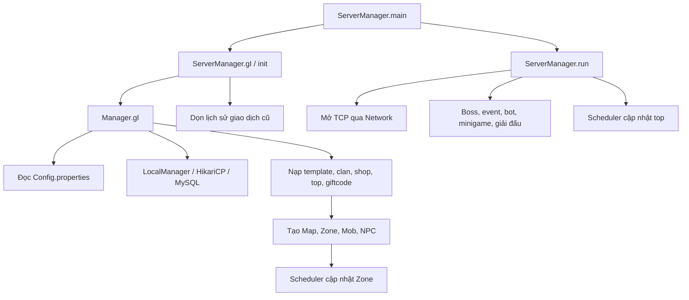
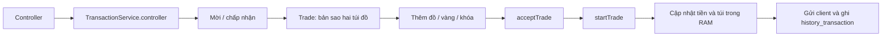

# Đọc và phân tích mã nguồn Teamobi2026

Ngày phân tích: 02/10/2026. Quy trình được chọn từ skill `skill-ai`: GitNexus → khám phá kiến trúc → đối chiếu trực tiếp mã nguồn.

Đây là server game Ngọc Rồng viết bằng Java, tổ chức theo NetBeans/Ant, kết nối MySQL qua HikariCP và giao tiếp client bằng gói tin nhị phân trên TCP. Phần lớn nghiệp vụ nằm trong các singleton service và trạng thái `Player`, `Zone`, `Manager` dùng chung giữa nhiều luồng.

## Phạm vi và kết quả

| Hạng mục | Kết quả |
| --- | --- |
| Mã nguồn | 548 tệp Java trong `SRC/src`, 76 package |
| Tổng số dòng | 104.276, gồm dòng trắng và chú thích |
| Dung lượng Java | 4.148.479 byte |
| GitNexus | 548 tệp, 17.725 nút, 74.166 liên kết |
| Nhóm chức năng trong đồ thị | 278 |
| Luồng do công cụ nhận diện | 300 |
| SQL | Hai bản dump, mỗi bản 41 bảng |
| Kiểm thử có sẵn | Không có tệp trong `SRC/test` |
| Cấu hình biên dịch | Java source/target 17 |

Toàn bộ tệp Java đã được đọc bởi chương trình kiểm kê và lập chỉ mục GitNexus. Tôi đã đọc trực tiếp các phần triển khai cốt lõi để đối chiếu luồng hoạt động và các phát hiện bên dưới. Phạm vi này là phân tích tĩnh toàn bộ cấu trúc, kèm đọc sâu các luồng chính; không có nghĩa mọi nhánh trong hơn 100 nghìn dòng đã được kiểm chứng bằng chạy game.

Ảnh, dữ liệu nhị phân, `.class` và `.jar` được phân loại là tài nguyên/thư viện/bản build. SQL được đọc cấu trúc bảng; dữ liệu tài khoản và thông tin kết nối không được chép vào báo cáo. `item.xlsx` không phải mã thực thi Java và chưa được diễn giải từng ô.

- [Danh mục từng tệp, kiểu và chữ ký phương thức](CATALOG.md).
- [Kiểm kê JSON, SHA-256 từng tệp và cấu trúc SQL](inventory.json).
- Đồ thị: `SRC/src/.gitnexus/`.
- Registry riêng cho lần phân tích: `.analysis/gitnexus-home/`.

Các chữ ký trong danh mục được trích bằng biểu thức chính quy, có giới hạn với khai báo nhiều dòng. Đồ thị GitNexus được tạo bằng bộ phân tích cú pháp, nhưng vẫn cần đối chiếu source khi có tên phương thức trùng, overload hoặc lời gọi qua interface. Một số liên kết mà công cụ suy ra không tương đương luồng chạy thực tế.

## Cấu trúc dự án

| Vị trí | Vai trò |
| --- | --- |
| `SRC/src` | Mã nguồn server |
| `SRC/lib` | Thư viện để biên dịch: Lombok, HikariCP, MySQL JDBC, JSON/Gson, logging; cũng có MongoDB driver |
| `SRC/data` | Map, tile, icon, part, effect và dữ liệu cập nhật client |
| `SRC/nbproject`, `SRC/build.xml` | Cấu hình NetBeans và Ant |
| `SRC/Config.properties` | Cấu hình server và database |
| `SRC/build`, `SRC/dist` | Sản phẩm build có sẵn |
| `SRC/20.jar` | JAR được `run.bat` thực sự chạy |
| `team2026.sql`, `SRC/sql/nro1.sql` | Bản dump schema và dữ liệu |

Điểm vào được cấu hình là [ServerManager.java](../../SRC/src/nro/models/server/ServerManager.java), dòng 82. `ShopTab.main()` là một điểm vào phụ, không phải main server theo cấu hình NetBeans.

`run.bat` chạy `20.jar`, trong khi tên JAR ở `dist` là `NgocRongOnline.jar`. Chưa đối chiếu bytecode để xác nhận `20.jar` khớp source hiện tại; khi triển khai sửa code cần kiểm tra JAR thực sự được chạy.

## Bản đồ các nhóm chức năng

| Package / nhóm | Trách nhiệm và nơi bắt đầu đọc |
| --- | --- |
| `server` — 11 tệp | `ServerManager` khởi động; `Manager` nạp template, tạo map và scheduler; `Controller` điều phối gói tin; `Client` quản lý online/logout; các lớp maintenance xử lý đóng server |
| `network` — 12 tệp, `interfaces` — 11 tệp | Accept TCP, session, handshake, gửi/nhận gói tin, key, quản lý session |
| `data` — 5 tệp, `database` — 7 tệp | `LocalManager` quản lý pool/JDBC; `MrBlue` xác thực và dựng player từ DB; `PlayerDAO` tạo/lưu nhân vật; `DataGame`, `ItemData` gửi dữ liệu client |
| `player` — 27 tệp | `Player` giữ trạng thái; `NPoint` tính chỉ số; `Inventory` giữ tiền và túi đồ; `Pet`, `NewPet`, hiệu ứng, hợp thể, học skill, sự kiện, thành tích và KOL |
| `map` — 6 tệp, `map.service` — 5 tệp | `Map` chứa các `Zone`; zone chứa player/boss/pet/mob/item; chuyển map, NPC, nhặt đồ và gửi thông tin khu |
| `map.phoban` — 6 tệp, `services_dungeon` — 10 tệp | Doanh trại, bản đồ kho báu, con đường rắn độc, khí gas, ngọc rồng đen, Ma Bư và siêu thần thủy |
| `services` — 22 tệp | Chiến đấu, inventory, item, player/pet, clan, nhiệm vụ, nội tại, radar, chat, quà và thành tích |
| `services_func` — 8 tệp | `UseItem`, `Input`, `Trade`, `TransactionService`, vòng quay, minigame, mua lại và hiệu ứng map |
| `combine` — 32 tệp | `CombineService` điều phối từng công thức; các lớp riêng xử lý ép sao, nâng cấp, bông tai, sách, chế tạo và phân rã |
| `item` — 2 tệp, `skill` — 3 tệp, `intrinsic` — 2 tệp | Mô hình vật phẩm/option, skill, class nhân vật và nội tại |
| `shop` — 12 tệp, `shop_ky_gui` — 3 tệp | Shop NPC/tab/item; đăng bán, mua, nhận tiền và lưu ký gửi |
| `npc` — 8 tệp, `npc_list` — 59 tệp | Factory NPC, menu nền và menu riêng từng NPC; nhiều chức năng được mở từ `confirmMenu` |
| `boss*` — 162 tệp | Boss nền, ID/data, 16 boss manager và các lớp boss theo nhóm/phó bản/sự kiện |
| `mob` — 5 tệp, `mob_bigboss` — 9 tệp | Quái thường, quái triệu hồi và quái lớn; sát thương, hồi sinh, rơi vật phẩm |
| `matches*` — 22 tệp, `managers` — 8 tệp | PVP, thách đấu, giải đấu, siêu hạng, top, giftcode và Shenron event |
| `clan` — 3 tệp, `task` — 10 tệp | Bang hội, thành viên/tin nhắn, nhiệm vụ chính/phụ/bang/danh hiệu |
| `event*`, `ievent` — 14 tệp | Event manager và các sự kiện theo mùa/nạp; cờ event cần đối chiếu lời gọi khởi tạo |
| `services.shenron` — 5 tệp | Gọi rồng, điều ước và vòng đời sự kiện rồng |
| `minigame` — 5 tệp, `Bot` — 7 tệp | Chọn ai đây, con số may mắn, bot chiến đấu/đánh quái/giao dịch |
| `player_badges` — 4 tệp, `daily_Giftcode` — 2 tệp, `radar` — 3 tệp | Danh hiệu, quà hằng ngày và thẻ radar |
| `consts` — 21 tệp, `utils` — 9 tệp | ID/hằng số, task/item/map/event, thời gian, random, file, logging và tiện ích |
| `player_system` — 3 tệp, `models` — 5 tệp | Template, giftcode và chống login; có các kiểu cùng tên giữa hai namespace |

Các lớp cùng tên cần chỉ rõ package: `models.Template` khác `nro.models.player_system.Template`; `NpcService` có ở cả `services` lẫn `map.service`; `TrainingService`, `SuperRank`, `GiftCode` cũng có nhiều phiên bản theo ngữ cảnh. Không thể kết luận bản nào thừa chỉ dựa trên tên.

## Luồng khởi động



`Manager` nạp dữ liệu trước khi `ServerManager.run()` mở socket. `LocalManager` khởi tạo HikariDataSource trong static initializer, đọc cấu hình bằng đường dẫn tương đối `Config.properties`. Các loader map cũng dùng đường dẫn tương đối dưới `data/`, nên thư mục làm việc khi chạy là một điều kiện thực tế của ứng dụng.

Source: [Manager.java](../../SRC/src/nro/models/server/Manager.java), dòng 168–241 và 288 trở đi; [LocalManager.java](../../SRC/src/nro/models/data/LocalManager.java), dòng 38 trở đi.

## Kết nối, đăng nhập và vào game

1. `Network` dùng `ServerSocketChannel` và `Selector` để accept socket, sau đó tạo `MySession`.
2. `ServerManager.sessionInit()` kiểm tra giới hạn theo IP, gắn `Controller`, `MessageSendCollect`, `MyKeyHandler`, rồi khởi động collector.
3. `Collector` đọc gói. Command `-27` xử lý key; các command khác gọi trực tiếp `Controller.onMessage()` trên luồng collector.
4. `Controller.messageNotLogin()` nhận username/password rồi gọi `MySession.login()`.
5. `MySession` kiểm tra chống login, trạng thái local/maintenance và tải server, sau đó gọi `MrBlue.login()`.
6. `MrBlue` truy vấn `account`, kiểm tra khóa/cooldown/trùng đăng nhập; nếu chưa có nhân vật thì mở tạo nhân vật, nếu có thì `loadPlayer()` dựng toàn bộ trạng thái từ các cột SQL/JSON.
7. Session gắn vào player; player được thêm vào zone và `Client`; gửi version, chỉ số, nhiệm vụ, clan và dữ liệu ban đầu.
8. `Controller.sendInfo()` gọi `player.start()` để mở vòng cập nhật riêng.

`QueueHandler` có trong source, nhưng đường nhận gói hiện tại của `Session.setMessageHandler()` gắn handler trực tiếp vào `Collector`. Vì vậy không nên mô tả giới hạn 500 message của `QueueHandler` là cơ chế bảo vệ chắc chắn của luồng nhận đang chạy.

Source: [Network.java](../../SRC/src/nro/models/network/Network.java), [Session.java](../../SRC/src/nro/models/network/Session.java), [Collector.java](../../SRC/src/nro/models/network/Collector.java), [MySession.java](../../SRC/src/nro/models/network/MySession.java), [MrBlue.java](../../SRC/src/nro/models/database/MrBlue.java), [Controller.java](../../SRC/src/nro/models/server/Controller.java).

## Vòng cập nhật và chiến đấu

`Manager.initMap()` chạy một scheduler mỗi 1 giây, chia zone thành nhóm tối đa 10, gửi vào executor và chờ hoàn tất. `Zone.update()` cập nhật mob, item, player và NPC không tương tác. `Zone.udPlayer()` gọi `Player.update()` cho các đối tượng thuộc nhóm thích hợp.

Đồng thời `Player.start()` tạo executor riêng; `Player.run()` cũng gọi `update()` với mục tiêu mỗi 1 giây. Pet, hợp thể, hiệu ứng, nhiệm vụ, danh hiệu, hồi HP/MP và nhiều điều kiện map được cập nhật bên trong `Player.update()`.

`Map.run()` chứa scheduler 5 giây và chú thích nói 1 giây, nhưng không tìm thấy lời gọi trực tiếp khởi động `Map.run()` trong source. Luồng map hiện đã xác minh là scheduler 1 giây trong `Manager`, nên không thể kết luận toàn server tick map mỗi 5 giây.

`Controller` chuyển yêu cầu đánh sang `SkillService`; lớp này kiểm tra mục tiêu, mana, cooldown và hiệu ứng trước khi phân nhánh skill đánh/buff/đặc biệt. `NPoint` tính chỉ số; `Player.injured()` và `Mob.injured()` xử lý nhận sát thương. Boss kế thừa `Player`, có máy trạng thái `REST → RESPAWN → JOIN_MAP → CHAT_S → ACTIVE → DIE → CHAT_E → LEAVE_MAP` với các nhánh AFK và thay đổi riêng từng boss.

Source: [Manager.java](../../SRC/src/nro/models/server/Manager.java), dòng 199; [Zone.java](../../SRC/src/nro/models/map/Zone.java), dòng 182, 250; [Player.java](../../SRC/src/nro/models/player/Player.java), dòng 419; [SkillService.java](../../SRC/src/nro/models/services/SkillService.java), dòng 47; [Boss.java](../../SRC/src/nro/models/boss/Boss.java), dòng 337.

## Vật phẩm, shop, nâng cấp và giao dịch

`Item` chứa template, số lượng và options. `InventoryService` quản lý thêm/bớt/chuyển túi, body, box và đồng bộ giao thức client. `UseItem` nhận hành động dùng/vứt/chuyển đồ, hủy giao dịch đang mở khi cần, rồi điều phối logic theo type/ID vật phẩm.

`CombineService` đọc `player.combineNew.typeCombine`, gọi lớp công thức tương ứng và reset trạng thái combine. Các thay đổi về vật phẩm thường liên quan đồng thời đến `ConstItem`, template SQL, `UseItem`, `ItemService`, `NPoint` hoặc `SetClothes`, shop và phần tải/lưu player.

Giao dịch dùng command `-86`:



`Trade.startTrade()` sửa trạng thái trong RAM và ghi lịch sử. Không thấy một transaction DB bao trùm việc lưu cả hai player trong phương thức này. Việc lưu nhân vật diễn ra qua `PlayerDAO.updatePlayer()` ở các đường khác; tính nhất quán khi mất kết nối, crash hoặc xử lý đồng thời cần kiểm chứng riêng.

Source: [UseItem.java](../../SRC/src/nro/models/services_func/UseItem.java), [InventoryService.java](../../SRC/src/nro/models/services/InventoryService.java), [CombineService.java](../../SRC/src/nro/models/combine/CombineService.java), [TransactionService.java](../../SRC/src/nro/models/services_func/TransactionService.java), [Trade.java](../../SRC/src/nro/models/services_func/Trade.java).

## Dữ liệu và lưu nhân vật

Cả hai dump có 41 bảng và cùng tập tên cột ở các bảng tương ứng. Điều này không chứng minh mọi kiểu/default/index hoặc dữ liệu giữa hai dump giống nhau.

| Nhóm | Bảng tiêu biểu |
| --- | --- |
| Tài khoản / nhân vật | `account`, `player`, `clan`, `super_rank` |
| Template | `item_template`, `item_option_template`, `map_template`, `mob_template`, `npc_template`, `skill_template`, `part`, `intrinsic`, `radar` |
| Shop / kinh tế | `shop`, `tab_shop`, `item_shop`, `item_shop_option`, `shop_ky_gui`, `history_transaction`, `giftcode` |
| Nhiệm vụ / thành tích | `task_main_template`, `task_sub_template`, `side_task_template`, `clan_task_template`, `achievement_template`, `task_badges_template`, `data_badges` |
| Bảng website/quản trị có trong dump | `adminpanel`, `posts`, `comments`, `settings`, `payments`, `bank_transfers`, `napthe` |

Phần website/quản trị trong dump không đồng nghĩa có mã website tương ứng trong `SRC/src`.

Nhiều trường của `player` chứa JSON trong `text`/`varchar`: inventory, vị trí, chỉ số, đồ, pet, skill, task và event. Có các mảng JSON được lưu dưới dạng chuỗi bên trong mảng khác. `MrBlue.loadPlayer()` và `PlayerDAO.updatePlayer()` phải giữ cùng thứ tự phần tử; thay schema JSON cần thay cả phần đọc, phần ghi và dữ liệu mặc định tạo nhân vật.

`ResultSetImpl` đọc kết quả JDBC vào cấu trúc RAM rồi đóng ResultSet/Statement. Vì vậy `LocalManager.executeQuery()` trả wrapper dữ liệu đã sao chép, không phải ResultSet JDBC còn sống; không thể kết luận lỗi chỉ từ việc connection đóng trước khi người gọi đọc wrapper.

Logout theo `Client.remove()` thực hiện: thoát map, hủy giao dịch, cập nhật clan/rồng/pet, lưu `PlayerDAO.updatePlayer()`, dispose, ghi `last_time_logout` và đóng session. Đóng server còn lưu clan và ký gửi trước khi kick người chơi.

Không tìm thấy nơi sử dụng `Manager.DAO_AUTO_UPDATER` ngoài khai báo và đọc cấu hình. Do đó cờ `server.daoautoupdater` trong source này chưa đủ để bảo đảm có autosave định kỳ.

## Các điểm cần chú ý đã đối chiếu source

Các mục “xác nhận tĩnh” dựa trên điều kiện và lời gọi thấy trong source. Các hậu quả phụ thuộc lịch chạy nhiều luồng hoặc trạng thái game được ghi là rủi ro; chưa thực nghiệm trên server.

| Mức ưu tiên | Phát hiện | Bằng chứng / tác động |
| --- | --- | --- |
| Cao | Điều kiện kiểm tra số lượng/giá ký gửi không thể đúng | `ConsignShopService`, dòng 398, 405, 418 dùng `quantity > 99 && quantity < 0` và các điều kiện tương tự cho tiền. Kiểm tra giới hạn trên này không hoạt động. Đã đối chiếu `Controller`, dòng 108: đường gói tin hiện chặn `quantity <= 0` trước khi gọi `KiGui()`, nhưng vẫn không áp dụng giới hạn 99 ở đây. Chưa kết luận có thể gửi số lượng âm qua đường này |
| Cao | Một player có hai đường cập nhật | `Manager.initMap → Zone.update → Player.update` và `Controller.sendInfo → Player.start → Player.run → Player.update`. Hai đường khởi động tồn tại; có rủi ro cập nhật trùng và sửa đồng thời cùng trạng thái |
| Cao | Xác nhận giao dịch chưa gắn riêng từng người | `Trade.acceptTrade()`, dòng 346 chỉ tăng một biến `accept`; `TransactionService`, dòng 155 trở đi gọi hàm không truyền người xác nhận. Không thấy hai cờ xác nhận riêng hoặc kiểm tra trạng thái khóa trong đường này; cần kiểm thử xử lý gói lặp |
| Trung bình | Giảm bộ đếm IP hai lần trong callback ngắt | `ServerManager.sessionDisconnect()`, dòng 213 gọi `Client.kickSession()`, đường này qua `Client.remove()` dòng 82 giảm IP; callback sau đó lại gọi `ServerManager.disconnect()`. Giới hạn kết nối có thể bị đếm thiếu |
| Trung bình | Tự bảo trì chạy hai vòng `run()` | `ServerManager`, dòng 116 tạo `new Thread(AutoMaintenance.gI()).start()`, dòng 118 lại gọi `AutoMaintenance.gI().start()`. Lớp này extends Thread và có các biến instance dùng chung; có rủi ro thông báo và trạng thái bảo trì chạy trùng |
| Trung bình | Kiểm tra hết hạn giftcode không dùng thời gian hiện tại | `player_system.GiftCode.timeCode()`, dòng 29 so `datecreate > dateexpired`. Với khoảng thời gian hợp lệ, code hết hạn sau đó không được nhận diện theo thời gian hiện tại |
| Trung bình | Giftcode được tiêu hao trước bước kiểm tra hạn | `GiftCodeManager.checkUseGiftCode()` giảm count, đánh dấu đã dùng và lưu; `GiftCodeService` sau đó mới gọi `timeCode()`. Thứ tự này có thể tiêu hao code trước khi hoàn tất phát thưởng |
| Trung bình | Nhánh cập nhật top sự kiện 2 ghi nhầm top 1 | `ServerManager.updateTop()`, dòng 184–185 dùng `Topsukien1` và `queryTopsukien1` khi `isTopSukien2Changed`; không dùng dữ liệu top sự kiện 2 |
| Trung bình | Mật khẩu được so sánh trực tiếp với dữ liệu DB | `MrBlue.login()`, dòng 65 dùng `username = ? and password = ?` với `session.pp`; chưa thấy bước xác minh password hash ở phía server. Chưa xác minh client có biến đổi password trước khi gửi hay không |
| Trung bình | Executor riêng của player không có vòng đời rõ ràng | `Player.start()`, dòng 429 tạo `newSingleThreadExecutor()` không giữ tham chiếu. Vòng player có thể kết thúc khi disconnect nhưng executor không được shutdown trong đường đã đọc; có rủi ro tích lũy thread qua nhiều lượt login |
| Trung bình | Hàng gửi không đặt giới hạn | `Sender` dùng `new LinkedBlockingDeque<>()` và thêm gói không kiểm tra capacity; client đọc chậm có thể làm hàng gửi tăng. Giới hạn ở `QueueHandler` không áp dụng cho Sender |
| Trung bình | Cấu trúc online và giao dịch dùng collection thường | `Client` dùng `HashMap`/`ArrayList`; `TransactionService.PLAYER_TRADE` là `HashMap`; collector và các vòng update chạy nhiều luồng. Cần kiểm tra quyền sở hữu/khóa quanh thao tác trên trạng thái chung |
| Trung bình | Thu phí ký gửi trước khi xác thực món hàng | `ConsignShopService.KiGui()`, dòng 380 trừ phí trước kiểm tra option cấm, giá, quantity và moneyType. Yêu cầu không hợp lệ có thể làm người chơi mất phí |
| Thấp | Reset quà dùng tên database cố định khác cấu hình | `ServerManager.resetNhanQuaHangNgay()` dùng `ngocrong`, trong khi cấu hình hiện chọn `team2026`. Nếu hàm được gọi, đích reset có thể khác DB game; chưa xác nhận đường gọi thực tế |
| Thấp | Cờ bật event không luôn tương ứng event được init | `EventManager.init()` có nhiều lời gọi bị comment. Hiện trực tiếp init `Default`, `HungVuong`, `TopUp`; không nên suy ra tất cả event đang hoạt động từ các cờ `true` |
| Thấp | Chú thích và đường chạy cần phân biệt | `Map.run()` đặt 5000 ms dù chú thích ghi 1 giây; đường scheduler chính nằm ở `Manager`. Chưa thấy caller của `Map.run()` |

Source liên quan: [ConsignShopService.java](../../SRC/src/nro/models/shop_ky_gui/ConsignShopService.java), [InventoryService.java](../../SRC/src/nro/models/services/InventoryService.java), [Trade.java](../../SRC/src/nro/models/services_func/Trade.java), [TransactionService.java](../../SRC/src/nro/models/services_func/TransactionService.java), [ServerManager.java](../../SRC/src/nro/models/server/ServerManager.java), [Client.java](../../SRC/src/nro/models/server/Client.java), [GiftCode.java](../../SRC/src/nro/models/player_system/GiftCode.java), [GiftCodeManager.java](../../SRC/src/nro/models/managers/GiftCodeManager.java), [GiftCodeService.java](../../SRC/src/nro/models/services/GiftCodeService.java), [Sender.java](../../SRC/src/nro/models/network/Sender.java), [EventManager.java](../../SRC/src/nro/models/event/EventManager.java).

## Cách tra cứu khi sửa chức năng

| Muốn tìm / sửa | Đọc theo thứ tự |
| --- | --- |
| Đăng nhập / tài khoản | `Controller.messageNotLogin → MySession.login → MrBlue.login → loadPlayer → PlayerDAO` |
| Chỉ số / sát thương / skill | `SkillService → NPoint → Player.injured / Mob.injured → EffectSkillService` |
| Túi đồ / dùng item | `Controller → UseItem → InventoryService → ItemService`; đối chiếu load/save và template SQL |
| Nâng cấp / combine | Menu NPC → `CombineService` → lớp công thức cụ thể → inventory |
| Boss / phần thưởng | `BossID → BossesData → BossManager.createBoss → lớp boss → reward` |
| NPC / menu | `NpcFactory → npc_list/<NPC> → openBaseMenu / confirmMenu` |
| Chuyển map / phó bản | `ChangeMapService → MapService → Map / Zone → services_dungeon` |
| Nhiệm vụ | `ConstTask → TaskService → TaskMain / TaskPlayer → template SQL` |
| Ký gửi / giao dịch | `ConsignShopService / TransactionService → Trade / ConsignShopManager → DAO / inventory` |
| Lưu nhân vật | `MrBlue.loadPlayer ↔ PlayerDAO.createNewPlayer / updatePlayer ↔ schema player` |
| Bảo trì | `ServerManager → AutoMaintenance / Maintenance → Client.close → PlayerDAO` |

Để truy vấn lại đồ thị trong PowerShell, dùng file `.cmd` vì execution policy hiện chặn shim `.ps1`:

```powershell
$env:GITNEXUS_HOME = 'C:\Users\Admin\Downloads\nroteam\Teamobi2026\.analysis\gitnexus-home'
gitnexus.cmd query 'login player' -r Teamobi2026-source -l 3
gitnexus.cmd context login -r Teamobi2026-source -f nro/models/network/MySession.java
gitnexus.cmd context initMap -r Teamobi2026-source -f nro/models/server/Manager.java
gitnexus.cmd cypher -r Teamobi2026-source 'MATCH (n:File) RETURN count(n) AS files'
```

Để cập nhật chỉ mục sau khi sửa source:

```powershell
$env:GITNEXUS_HOME = 'C:\Users\Admin\Downloads\nroteam\Teamobi2026\.analysis\gitnexus-home'
gitnexus.cmd analyze SRC/src --skip-git --index-only --name Teamobi2026-source --workers 2
python .analysis/catalog_source.py
```

Dự án hiện không có `.git` trong thư mục phân tích nên chỉ mục không theo dõi commit. Embeddings chưa được tạo; truy vấn hiện dùng graph và tìm kiếm từ khóa, không phải tìm kiếm vector.

## Xác minh đã thực hiện

- Lập chỉ mục thành công; `meta.json` ghi 548 files và truy vấn `MATCH (n:File)` trả 548, khớp kiểm kê filesystem.
- Đọc toàn bộ tệp Java để tạo SHA-256, đếm dòng và xuất danh mục. Script cũng đọc cả hai SQL dump để trích schema.
- Tra cứu GitNexus cho `MySession.login`, `Manager.initMap` và luồng inventory/trade; đối chiếu source trực tiếp vì đồ thị có thể suy ra liên kết dư.
- Thử biên dịch 548 tệp bằng JDK 21 với `--release 17`, thư viện local và Lombok. Compiler sinh output và trả mã 0, nhưng log có `AccessDeniedException` lúc đóng archive/JAR. Vì vậy chưa xác nhận build sạch; log ở `.analysis/compile.log`. Đây là giới hạn phép kiểm tra trong môi trường hiện tại, chưa phải kết luận source không biên dịch được.
- Không chạy server, không mở kết nối database, không chạy kiểm thử gameplay. Không sửa logic Java hay dữ liệu game.

Các tệp được thêm phục vụ phân tích là báo cáo/danh mục, script kiểm kê, log kiểm tra và chỉ mục GitNexus.
